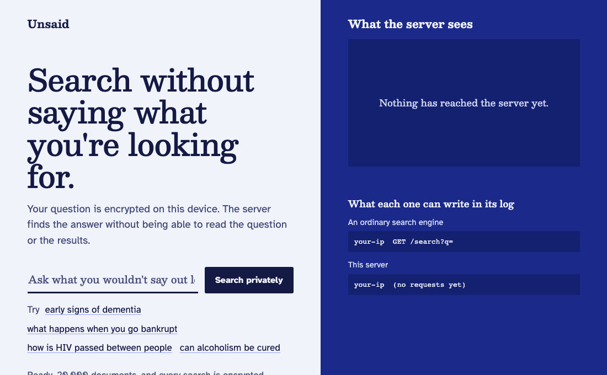

<h1 align="center">Unsaid</h1>

<p align="center"><strong>Search without saying what you're looking for.</strong></p>

<p align="center">
  <a href="https://dharmeshdev1.github.io/unsaid/"><strong>Try the live demo</strong></a> |
  <a href="docs/how-it-works.md">How it works</a> |
  <a href="tutorial">Build it from scratch</a> |
  <a href="docs/security.md">Security</a>
</p>

<p align="center">
  <a href="https://github.com/dharmeshdev1/unsaid/actions/workflows/ci.yml"></a>
  <a href="LICENSE"></a>
</p>

A search engine that cannot see what you search for. Your question is encrypted on your own device
with lattice cryptography, and the server finds relevant documents and returns them **without
learning the question or the results**.

This is not a promise to delete logs. Your question never reaches the server in a form it could log.

```text
What an ordinary search engine can write in its log:
  your-ip  GET /search?q=early+signs+of+dementia

What an Unsaid server can write in its log, whatever you asked:
  your-ip  POST /v1/rank   401408 bytes
  your-ip  POST /v1/fetch   49824 bytes
```

<p align="center"></p>

The pattern in that recording is the real request, one mark per byte. Everything runs in your browser
with no backend, and you can [try it yourself](https://dharmeshdev1.github.io/unsaid/).

## Try it

Download a binary from [Releases](https://github.com/dharmeshdev1/unsaid/releases), or build it:

```sh
cargo install --git https://github.com/dharmeshdev1/unsaid unsaid
```

Then run the demo, which indexes 1,000 sample articles in under a minute and serves a private search page. With `--watch`,
the server prints each query as it arrives, so you can see for yourself how little there is in it. These
are two searches for very different things:

```text
$ unsaid demo --watch
Private search at http://127.0.0.1:8377
Printing every query exactly as it arrives:

127.0.0.1  POST /v1/rank      81920 bytes  dbbf7740265d8a4906dd8945f91d1746...  answered in 1 ms
127.0.0.1  POST /v1/fetch      2464 bytes  79bf87540d72d77b56f0b885d77c163f...  answered in 0 ms
127.0.0.1  POST /v1/rank      81920 bytes  06d0d963867d2f32fd908fbe0afe34b1...  answered in 1 ms
127.0.0.1  POST /v1/fetch      2464 bytes  125f6f175f59475da849a3772edf89d5...  answered in 0 ms
```

## Search your own documents

Point it at a folder of text, Markdown or HTML, or at a `.jsonl` file of `{"title", "text", "url"}`:

```sh
unsaid build ./my-notes --out my-index
unsaid serve my-index
```

```text
$ unsaid search "early signs of dementia" -k 1 --trace
1. Alzheimer's disease  (0.46)
   Alzheimer's Disease (AD) is a brain disease that slowly destroys brain cells. ...
   https://simple.wikipedia.org/wiki/Alzheimer%27s%20disease

sent 82 KB and received 36 KB. embed 5 ms, encrypt 14 ms, ranking 2 ms, pages 1 ms, decrypt 5.7 ms, held for timing 245 ms, total 272 ms
```

The index, and the server that holds it, can sit on any machine you do not fully trust.

## Use it from code or from an AI agent

**Any language.** Run a gateway on your own machine, and it does the embedding and encryption for you:

```sh
unsaid proxy --server https://search.example.com
curl -s localhost:8378/search -d '{"query": "sleep and memory", "limit": 3}' -H 'content-type: application/json'
```

**AI agents.** An agent's searches reveal what it is working on, just as yours do. `unsaid mcp` gives
any [Model Context Protocol](https://modelcontextprotocol.io) client a `private_search` tool:

```json
{
  "mcpServers": {
    "unsaid": { "command": "unsaid", "args": ["mcp", "--server", "https://search.example.com"] }
  }
}
```

**Private RAG.** [`examples/private_rag.py`](examples/private_rag.py) retrieves context privately and
answers with a local model, so nothing reads the question except your own computer.

## How well it works

Everything below goes through the real protocol with real encryption. Nothing is simulated.

**Quality.** Compared with exact search using the same embedding model, on the [BEIR](https://github.com/beir-cellar/beir) benchmark:

| Dataset | Documents | Exact nDCG@10 | Unsaid nDCG@10 | Share of exact |
| --- | --- | --- | --- | --- |
| SciFact | 5,183 | 0.6230 | 0.5969 | 95.8% |
| ArguAna | 8,674 | 0.4995 | 0.4910 | 98.3% |
| FiQA | 57,638 | 0.3662 | 0.3309 | 90.3% |
| NQ | 2,681,468 | 0.3911 | 0.3745 | 95.8% |

**Speed.** On an Apple M5 laptop with client and server on one machine, so with no network time:

| Corpus | Documents | Download once | Per search | Server memory | Server time, 10 cores | Server time, 1 core | Whole search |
| --- | --- | --- | --- | --- | --- | --- | --- |
| Wikipedia sample | 20,000 | 37 MB | 441 KB up, 48 KB down | 62 MB | 6 ms | 11 ms | 0.34 s |
| Simple English Wikipedia | 346,616 | 50 MB | 2.3 MB up, 96 KB down | 350 MB | 32 ms | 82 ms | 0.60 s |
| BEIR NQ | 2,681,468 | 98 MB | 5.1 MB up, 320 KB down | 1.9 GB | 99 ms | 405 ms | 1.1 s |

A whole search includes a 250 ms hold that hides timing from the server, and the upload is the real cost
on a slow connection. One core serves about 12 searches a second over all of Simple English Wikipedia.

[Full results and the commands to reproduce them.](docs/benchmarks.md)

## How it works

1. **Your device turns the question into a vector** with a small neural network that runs locally, and
   uses a public map to pick a few groups of documents likely to hold the answer.
2. **It encrypts that vector** using learning with errors, the hard problem behind ML-KEM, with a
   secret used only once.
3. **The server multiplies its whole index by the ciphertext.** This is the one operation the encryption
   allows without a key. The server touches every document equally, so it cannot tell which ones
   mattered, and it returns scores it cannot read.
4. **Your device decrypts the scores** and fetches the best documents the same way.

Every search sends the same requests with the same sizes, whatever was asked.
[The full explanation](docs/how-it-works.md) assumes no cryptography.

## How it compares

| | Server reads your question | You need a copy of all the data | Search by meaning | Runs on one machine |
| --- | --- | --- | --- | --- |
| Ordinary search or RAG API | Yes | No | Yes | Yes |
| Search engine that promises no logs | Yes, then promises to forget | No | Often | Yes |
| VPN or Tor | Yes, just not who you are | No | Depends | Yes |
| Search on your own device | No | Yes | Yes | Yes |
| [Tiptoe](https://github.com/ahenzinger/tiptoe), research prototype | No | No | Yes | No, it needs a large cluster |
| **Unsaid** | **No** | **No** | **Yes** | **Yes** |

**If your data is small and public, download it and search it locally.** Nothing is more private than
that. Unsaid is for data that is too large to hand out, changes often, or belongs to someone else.

## What it does not hide

- **Your IP address, and when and how often you search.** A VPN or Tor hides the address, but not the
  timing.
- **That you use this index at all.** Searching an index about one illness reveals that topic.
- **Which result you open**, if you follow its link to another site.

It also cannot prove that the server answered honestly, and it does not keep the documents secret from
the people searching them. **This code has not had an independent audit**, so please do not rely on it
where a mistake could hurt someone. [The security notes](docs/security.md) cover the threat model,
how the lattice parameters were chosen, and what is known to be weak.

## Learn from it

You can understand this entire system in an afternoon, with nothing more than linear algebra:

- [`tutorial/`](tutorial) builds it in Python, from noisy equations to a complete client of about 250
  lines that talks to the real Rust server.
- [How it works](docs/how-it-works.md) explains the ideas in plain language.
- [The protocol](docs/protocol.md) is short enough to read in one sitting, and has test vectors.
- [Ideas to build on this](docs/project-ideas.md) lists projects from a weekend to a thesis, each with
  a way to measure whether it worked.

## What is in here

| Path | What it is |
| --- | --- |
| [`crates/unsaid-lwe`](crates/unsaid-lwe) | The encryption, the sampler and the noise budget |
| [`crates/unsaid-embed`](crates/unsaid-embed) | A BERT encoder in safe Rust, the same natively and in the browser |
| [`crates/unsaid-core`](crates/unsaid-core) | The protocol: manifest, pages and a client with no I/O in it |
| [`crates/unsaid-build`](crates/unsaid-build) | PCA, balanced k-means and index construction |
| [`crates/unsaid-server`](crates/unsaid-server) | The HTTP server |
| [`crates/unsaid-cli`](crates/unsaid-cli) | The `unsaid` command, the gateway and the MCP tool |
| [`crates/unsaid-wasm`](crates/unsaid-wasm), [`web`](web) | The browser client and interface |

Everything is one 5 MB binary. `unsafe` is forbidden in every crate except the WebAssembly bindings.

## Roadmap

- Smaller uploads and hints, using packed ciphertexts as in [YPIR](https://eprint.iacr.org/2024/270)
- Proofs that an answer came from the published index
- Adding documents without a full rebuild
- An independent security review

## Credits

Unsaid stands on [SimplePIR](https://eprint.iacr.org/2022/949) by Henzinger, Hong, Corrigan-Gibbs,
Meiklejohn and Vaikuntanathan, and on [Tiptoe](https://eprint.iacr.org/2023/1438) by Henzinger, Dauterman,
Corrigan-Gibbs and Zeldovich, which showed that private search can work at web scale. Embeddings come
from [all-MiniLM-L6-v2](https://huggingface.co/sentence-transformers/all-MiniLM-L6-v2). The demo text
is from [Simple English Wikipedia](https://simple.wikipedia.org), under CC BY-SA 4.0.

## License

[Apache 2.0](LICENSE). See [NOTICE](NOTICE) for the models, fonts and text it uses.
