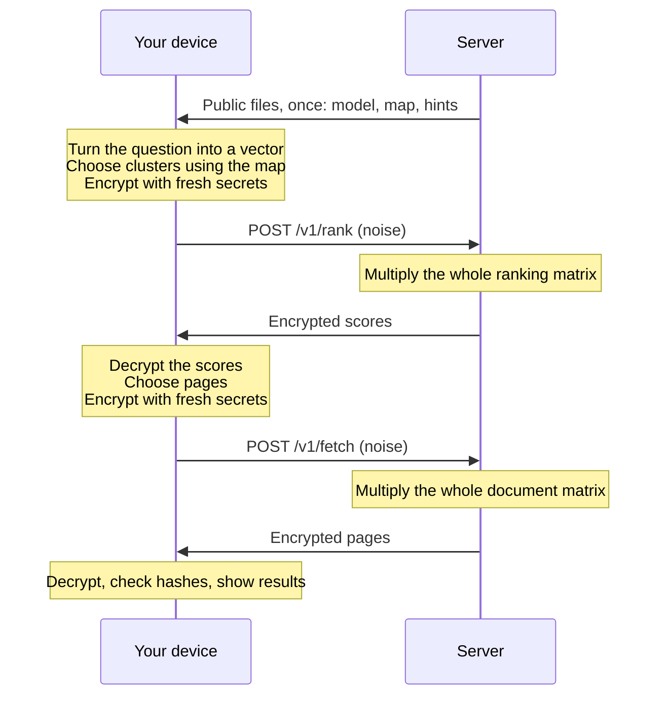

# How it works

This page explains the whole system without assuming any cryptography. If you would rather read
code, [`tutorial/`](../tutorial) builds the same ideas in a few short Python files.

## The problem

When you search, your question reaches a computer you do not control. HTTPS protects it on the way
there. It does nothing once it arrives, because the server has to read the question to answer it.
A promise not to keep logs is only a promise, and it can be broken by a mistake, a breach, a new
owner or a court order.

So the real question is this: can a server find an answer to a question it cannot read?

## The one trick

Learning with errors (LWE) is the hard problem behind ML-KEM, the post-quantum standard that browsers
now use for key exchange. Its encryption has a rare property: **anyone can multiply a ciphertext by
a plain matrix of their own, without the key, and get an encryption of the product.**

```text
   query x, encrypted:     b  =  A s + e + delta x

   server computes:        M b  =  (M A) s  +  M e  +  delta (M x)
                                   ^^^^^^^^     ^^^     ^^^^^^^^^^^
                                   client       tiny    the answer,
                                   can remove   noise   scaled up
```

Here `s` is a secret used once, `e` is small random noise, and `A` is a big public random matrix.
`M` is the server's data. The server sees `b`, which is indistinguishable from random numbers, and
sends back `M b`. The client knows `s`, and it downloaded `H = M A` ahead of time. That is called the
hint, and it says nothing about any query. So the client computes `M b - H s` and rounds the noise
away, leaving `M x`.

The server has now computed a matrix product for a vector it never saw. Everything else is about
choosing what `M` and `x` should be. This scheme is SimplePIR, by Henzinger, Hong, Corrigan-Gibbs,
Meiklejohn and Vaikuntanathan.

## Search is a matrix product

A neural network can turn text into a vector, so that texts with similar meanings get vectors that
point in similar directions. To rank documents, you compute the dot product of the question's
vector with each document's vector. Put the document vectors in the rows of a matrix `M`, and the
whole ranking is `M x`. That is exactly the operation we can do on encrypted data.

Fetching a document is a matrix product too. Put documents in the columns of `M`, and let `x` be all
zeros with a single 1. Then `M x` is that column. This is called private information retrieval, and
the server cannot tell which column you took because the multiplication touches all of them.

## Why clusters

A ciphertext has one number per column of `M`. If every document had its own columns, every search
would have to upload something as large as the index. So documents are grouped by meaning, and the
ranking matrix is laid out like this:

```text
                 cluster 0        cluster 1        cluster 2
              [ d dimensions ] [ d dimensions ] [ d dimensions ]
  row 0       doc 0 of c0      doc 0 of c1      doc 0 of c2
  row 1       doc 1 of c0      doc 1 of c1      doc 1 of c2
  ...
```

The client puts its vector into the columns of one cluster and zeros everywhere else. Each row of
the answer is then the score of one document in that cluster. The upload grows with the number of
clusters rather than the number of documents, and the answer has one number per row.

The server still multiplies by the entire matrix, so it cannot tell which cluster was asked for.

## Choosing clusters without telling anyone

The client needs to know which clusters are likely to hold the answer. The index publishes a small
map for that: for each cluster, up to 32 prototype vectors summarising what it contains. Everyone
downloads the same map, so the choice happens entirely on your device.

A question often sits near a boundary between clusters, so the client asks about several at once.
These are called probes, and each one is another encrypted query. All of this is why the default
of 8 probes works so well in the [benchmarks](benchmarks.md): searching one cluster with a single
centre, as earlier systems did, reached 62 to 88% of exact search quality in our experiments, while
8 probes with prototypes reach 95 to 98%.

## Getting the documents

Scores say which documents are best but the client still needs their text. Documents are compressed
into fixed-size pages, and neighbours in meaning share a page, so one fetch often brings back several
good results. The client asks for the 4 pages holding its best documents, with one encrypted query
per page. It then checks each page against a published hash.

## The whole conversation



Every search makes these two requests with these exact sizes, whatever you asked and whatever came
back. Nothing about the traffic depends on your question.

## What it costs

There is no free lunch, and the cost falls in three places:

- **A one-time download.** The model, the map and the hints, about 50 MB for a few hundred thousand
  passages. Hints can be shared by every client and every search.
- **Upload per search.** A few megabytes at that scale, since each query needs one number per column.
- **Server arithmetic.** The server reads its whole index for every search. That is the price of
  not knowing which part you wanted, and it is why the multiply loop is the most tuned code here.

The [benchmarks page](benchmarks.md) has measurements of all three.

## Where this came from

The cryptography and the overall shape are not new. [SimplePIR](https://eprint.iacr.org/2022/949)
gave the fast linear scheme. [Tiptoe](https://eprint.iacr.org/2023/1438) showed that private
search works at web scale over 360 million pages, using a cluster of machines, and is the direct
inspiration for clustering and ranking this way. Unsaid is an attempt to make that idea something
anyone can run: one small binary, your own documents, an ordinary machine and a browser, with
client-side routing tuned to get close to exact search on real benchmarks.
